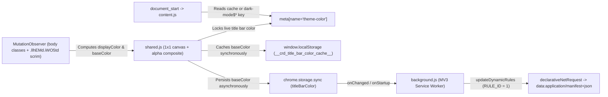

# Technical Documentation — Title Bar Theme for Chrome Remote Desktop

Architecture, Google Wiz DOM theme and dialog scrim detection, PWA manifest redirection, permission boundaries, and Chrome Web Store packaging across [`manifest.json`](../manifest.json), [`source/shared.js`](../source/shared.js), [`source/content.js`](../source/content.js), [`source/background.js`](../source/background.js), and [`build.ps1`](../build.ps1).

## 1. Architecture & Repository Layout

```text
chrome-extension-theme-for-remote-desktop/
├── .gitignore                        # Ignores package/, *.zip, *.crx, *.pem, *.htmd
├── assets/
│   ├── icon16.png                    # Toolbar and extension icons
│   ├── icon48.png
│   ├── icon128.png                   # Chrome Web Store listing icon
│   └── screenshot-1280x800.png       # Chrome Web Store & README preview screenshot (excluded from .zip)
├── docs/
│   ├── privacy.md                    # Zero-collection privacy policy
│   └── technical.md                  # Wiz observer architecture, scrim math & packaging reference
├── source/
│   ├── background.js                 # MV3 service worker: declarativeNetRequest redirect & tab re-injection
│   ├── content.js                    # Top-level document observer: theme, dialog scrim & meta lock
│   └── shared.js                     # Shared guards, 1x1 canvas CSS color resolver, alpha blender & meta helper
├── build.ps1                         # Validates manifest paths and packages package\<repo>-v<ver>.zip
├── manifest.json                     # Extension Manifest V3 (kept at root for Load unpacked)
└── readme.md                         # User-facing overview, preview, installation & companion links
```

**Why `manifest.json` stays at the repository root:** Chrome's `chrome://extensions` **Load unpacked** flow requires `manifest.json` directly inside the selected directory and disallows `../` parent path traversal in extension resource URLs. Because Chrome Remote Desktop renders its Wiz application directly inside the top-level document, no cross-origin iframe observer is needed.



## 2. Design Constraints & Rationale

On Windows, Chromium drives a standalone PWA window frame and launch screen from two independent signals: `<meta name="theme-color">` in the top-level document `<head>` for the live window title bar, and the Web App Manifest (`theme_color` and `background_color` in `/_/RemotingUi/manifest.json`) evaluated before any page script executes for the cold-launch splash screen.

Three behaviors on `https://remotedesktop.google.com/` leave the PWA frame unmatched out of the box:

1. **Missing Metadata:** The HTML document omits `<meta name="theme-color">`, and `/_/RemotingUi/manifest.json` omits `theme_color`, falling back to Chrome's default frame color.
2. **Minified Wiz Classes & Modal Scrims:** Theme state switches via minified Google Wiz classes on `document.body` (`afF7cb` Light `#fafafa`, `fv4cze` Dark `#212121`) and `--page-bg-color`, while modal dialogs (PIN prompts, host setup, settings) paint a full-viewport backdrop scrim (`.llhEMd.iWO5td`, `rgba(0, 0, 0, 0.5)`) without dimming the native desktop frame.
3. **Pre-`<body>` Startup Flash:** Waiting for asynchronous `chrome.storage` reads or body hydration flashes an unthemed title bar before DOM classes settle.

## 3. Core Components & Runtime Coordination

### 3.1 Shared Color & DOM Utilities ([`source/shared.js`](../source/shared.js))

Injected before `source/content.js` (`run_at: "document_start"`) and loaded inside the MV3 service worker via `importScripts('./shared.js')`, `source/shared.js` exposes an immutable `globalThis.TitleBarThemeShared` namespace.

- **Idempotent Guards & Orphan Teardown (`claimRuntimeGuard`, `isContextValid`):** `claimRuntimeGuard(flagName)` stores `chrome.runtime.id` on `globalThis[flagName]`. Re-injections during `chrome.runtime.onInstalled` no-op when the same extension runtime holds the guard, while stale listeners from a previous extension version detect `isContextValid() === false` and call `teardown()` to disconnect observers and listeners cleanly.
- **CSS Color Resolution & Scrim Blending (`resolveOpaqueRgb`, `parseCssColorWithAlpha`, `blendOverlayOntoBase`):** `#RRGGBB` and `rgb()`/`rgba()` strings parse directly via regex fast paths, while CSS custom properties and CSS Color 4 values fall back to a lazy `1x1` 2D `<canvas>` (`{ willReadFrequently: true }`) resolved by Chromium's color engine. When a translucent dialog scrim is visible, `blendOverlayOntoBase` computes the opaque title bar hex color via source-over compositing:

$$C_{\text{out}} = \text{round}\!\left(\alpha \cdot C_{\text{overlay}} + (1 - \alpha) \cdot C_{\text{base}}\right)$$

- **Non-Looping `<meta>` Synchronization (`applyThemeColorMeta`):** Exits early if a single `<meta name="theme-color">` tag with no `media` attribute already matches `color`; otherwise updates or creates it under `document.head || document.documentElement`, removes any `media` attribute, and deletes duplicate tags to prevent `MutationObserver` loops.

### 3.2 Wiz Theme & Dialog Scrim Observer ([`source/content.js`](../source/content.js))

Running at `run_at: "document_start"`, `detectFallbackStorageColor` paints `<meta name="theme-color">` synchronously before `document.body` exists by checking `window.localStorage['__crd_title_bar_color_cache__']`, or scanning Chrome Remote Desktop's own `localStorage['dark-mode$*']` keys on first run (`"true"` -> `#212121`, `"false"` -> `#fafafa`).

Once hydrated, `resolveBaseRgbFromDom` maps `body.fv4cze` (`#212121`) and `body.afF7cb` (`#fafafa`) and falls back to computed `--page-bg-color` on `document.body` so theme detection keeps working across minified class changes. `detectActiveOverlay` inspects visible `.llhEMd.iWO5td` dialog scrims (skipping `aria-hidden="true"`, `display: none`, `visibility: hidden`, and `pointer-events: none`, defaulting to `rgba(0, 0, 0, 0.5)`) and composites them over `baseRgb`:

| Theme | Base Header Color | Dialog Open (`50%` Scrim) |
| :--- | :--- | :--- |
| **Light** | `#fafafa` (`rgb(250, 250, 250)`) | `#7d7d7d` (`rgb(125, 125, 125)`) |
| **Dark** | `#212121` (`rgb(33, 33, 33)`) | `#111111` (`rgb(17, 17, 17)`) |

Live `displayColor` (including the 50% dialog scrim when open) drives `<meta name="theme-color">`, whereas only undimmed `baseColor` writes to `localStorage` and `chrome.storage.sync['titleBarColor']`, preventing dismissed dialogs from tinting the next cold-launch splash screen.

### 3.3 Service Worker & Manifest Redirect ([`source/background.js`](../source/background.js))

`updateManifestRedirectRule` reads `titleBarColor` from `chrome.storage.sync` (default `#fafafa`) and registers `chrome.declarativeNetRequest` dynamic rule `RULE_ID = 1` matching `https://remotedesktop.google.com/_/RemotingUi/manifest.json*` (`resourceTypes: ['other', 'xmlhttprequest', 'sub_frame', 'main_frame']`). The rule redirects the manifest fetch to an inline `data:application/manifest+json;charset=utf-8,...` URI preserving Chrome Remote Desktop's PWA identity (`start_url: "https://remotedesktop.google.com/?entry-point=pwa&lfhs=2"`, `id: "/?entry-point=pwa&lfhs=2"`, `display: "standalone"`, `orientation: "any"`, `icons`) with synchronized `background_color` and `theme_color`. On `chrome.runtime.onInstalled`, `reinjectOpenTabs` injects `source/shared.js` + `source/content.js` into open tabs (`frameIds: [0]`) so updates activate immediately without refreshing existing sessions.

## 4. Storage, Bridge & Permission Reference

| Key / Identifier | Scope / Channel | Format / Value | Role |
| :--- | :--- | :--- | :--- |
| `__crd_title_bar_color_cache__` | `window.localStorage` (`remotedesktop.google.com`) | `#rrggbb` | Synchronous zero-flash startup tint before `document.body` hydrates. |
| `dark-mode$*` | `window.localStorage` (read-only fallback) | `"true"` / `"false"` | First-launch polarity fallback before the extension cache exists. |
| `titleBarColor` | `chrome.storage.sync` (default `#fafafa`) | `#rrggbb` | Persisted `baseColor` driving service-worker manifest redirects. |
| `RULE_ID = 1` | `chrome.declarativeNetRequest` | Dynamic redirect rule | Rewrites `/_/RemotingUi/manifest.json*` to inline `data:application/manifest+json`. |

Defined in [`manifest.json`](../manifest.json) under least privilege:

| Permission / Host | Purpose | Boundary |
| :--- | :--- | :--- |
| `storage` | Syncs only the 7-character `titleBarColor` (`#rrggbb`) hex string across Chrome sessions. | Zero user profile, host list, or browsing data stored. See [`privacy.md`](./privacy.md). |
| `declarativeNetRequest` | Redirects `/_/RemotingUi/manifest.json*` to an offline `data:application/manifest+json` manifest with synchronized theme colors. | Native Chromium rule evaluation with no blocking `webRequest` interception. |
| `scripting` | Re-injects `source/shared.js` and `source/content.js` into open tabs inside `onInstalled`. | Scoped strictly to `https://remotedesktop.google.com/*`; `tabs` permission is omitted. |
| `https://remotedesktop.google.com/*` | Hosts the top-level Wiz theme/scrim observer and manifest redirect target. | Excludes all other websites and Google domains. |

## 5. Build, Debug & Packaging

```powershell
# Validate manifest.json entries and output package\chrome-extension-theme-for-remote-desktop-v<version>.zip
.\build.ps1

# Inspect packaged archive entries (7 forward-slash paths expected)
[System.IO.Compression.ZipFile]::OpenRead((Resolve-Path .\package\chrome-extension-theme-for-remote-desktop-*.zip)).Entries.FullName
```

Running [`build.ps1`](../build.ps1) validates every icon, background worker, and content script in [`manifest.json`](../manifest.json), collects runtime scripts under `source/`, and writes `package\chrome-extension-theme-for-remote-desktop-v<version>.zip` (`7` entries) using forward-slash (`/`) ZIP paths required by the Chrome Web Store upload validator while omitting `assets/screenshot-1280x800.png`, `docs/`, `readme.md`, and `*.htmd`. [`.gitignore`](../.gitignore) excludes `package/`, `*.zip`, `*.crx`, `*.pem`, and `*.htmd` from version control.

For unmanaged Enterprise policy deployment, sibling repository [powershell-software-installer](https://github.com/tbruneel/powershell-software-installer) provisions Chrome Web Store ID `goeedkphpabkkmajcmngohomgmdodgaf` under `HKLM:\SOFTWARE\Policies\Google\Chrome\ExtensionSettings` (`installation_mode = "normal_installed"`, `update_url = "https://clients2.google.com/service/update2/crx"`), which Chromium permits for Public or Unlisted items so end users retain enable/uninstall control.
