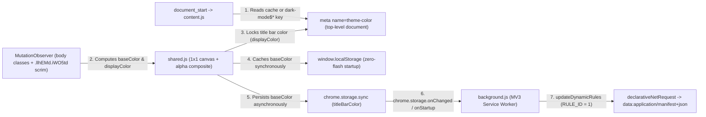

# Technical Documentation — Title Bar Theme for Chrome Remote Desktop

This document explains **what** is implemented in `chrome-extension-theme-for-remote-desktop`, **how** theme and modal scrim synchronization work, and **why** each architectural decision was made.

## 1. Problem Statement — Why Chrome Remote Desktop Has an Unmatched Title Bar

On Windows, Chromium paints a standalone Progressive Web App (PWA) window's title bar and launch splash screen from two signals:

- **Cold launch / splash screen:** `theme_color` and `background_color` inside the Web App Manifest (`/_/RemotingUi/manifest.json`) fetched when the PWA starts.
- **Live window title bar:** `<meta name="theme-color">` in the top-level HTML `<head>`.

In `https://remotedesktop.google.com/`, three platform behaviors cause an unthemed title bar and startup mismatch:

1. **Missing Theme Metadata:** The page omits `<meta name="theme-color">` from `<head>`, and `/_/RemotingUi/manifest.json` omits `theme_color`, leaving Chrome with no theme hint for the window title bar or launch splash.
2. **Google Wiz Framework Styling & Obfuscated Classes:** Theme polarity is toggled via minified Google Wiz CSS classes on `document.body` (`afF7cb` for Light `#fafafa`, `fv4cze` for Dark `#212121`) and `--page-bg-color`, while modal dialogs (PIN prompts, host setup, settings) render a full-viewport backdrop scrim (`.llhEMd.iWO5td`, `rgba(0, 0, 0, 0.5)` at `z-index: 5000`). Chromium does not dim the native title bar behind page scrims automatically.
3. **Pre-`<body>` Hydration Race & Launch Flash:** Reading `chrome.storage` asynchronously or waiting until `document.body` hydrates causes a visible flash of an unthemed title bar on startup.

## 2. Architecture & Repository Layout

### Tracked Repository Layout

```text
chrome-extension-theme-for-remote-desktop/
├── .agents/
│   └── rules/
│       └── rules-git.md            # Git commit identity rules
├── assets/
│   ├── icon16.png                  # Extension icons
│   ├── icon48.png
│   ├── icon128.png                 # Chrome Web Store listing icon
│   └── screenshot-1280x800.png     # Chrome Web Store listing screenshot (excluded from .zip)
├── docs/
│   ├── privacy.md                  # Privacy policy (Markdown)
│   ├── privacy.md.html             # Privacy policy (Standalone HTML)
│   ├── technical.md                # Technical documentation (Markdown)
│   └── technical.md.html           # Technical documentation (Standalone HTML)
├── src/
│   ├── background.js               # MV3 service worker: declarativeNetRequest & tab re-injection
│   ├── content.js                  # Top-level document observer: theme, dialog scrim & <meta> lock
│   └── shared.js                   # Shared guards, 1x1 canvas color resolver, alpha blender & DOM helper
├── build.ps1                       # Packages CWS-ready .zip archive into dist\
├── manifest.json                   # Extension Manifest V3 (kept at root for Load unpacked)
├── readme.md                       # Non-technical project overview (Markdown)
└── readme.md.html                  # Non-technical project overview (Standalone HTML)
```

Unlike the Google Antigravity extension, Chrome Remote Desktop renders its Wiz application directly in the top-level document, so no cross-origin iframe observer script is required.

**Why `manifest.json` stays at the repository root:** Chrome's `chrome://extensions` → **Load unpacked** requires `manifest.json` directly inside the selected folder and forbids `../` parent path traversal in extension URLs. Keeping [`manifest.json`](../manifest.json) at the root allows immediate developer-mode loading straight from the cloned repository without an extra staging step.

### End-to-End Signal Flow



## 3. Component Implementation & Design Rationale

### 3.1 Shared Color & DOM Utilities ([`src/shared.js`](../src/shared.js))

Shared between [`src/content.js`](../src/content.js) and [`src/background.js`](../src/background.js) (loaded via `importScripts('./shared.js')`):

- **Idempotent Runtime Guards & Orphan Teardown (`claimRuntimeGuard`, `isContextValid`):**
  - `claimRuntimeGuard(flagName)` records `chrome.runtime.id` on `globalThis[flagName]`. Re-injections during the same runtime no-op cleanly, while stale scripts left over after an extension update detect `isContextValid() === false` and invoke `teardown()` to disconnect `MutationObserver` and remove event listeners.
- **CSS Color 4 Rasterization (`resolveOpaqueRgb`, `parseCssColorWithAlpha`):**
  - Handles `#RRGGBB` and `rgb()`/`rgba()` directly via fast regex matching, with fallback to a lazy `1×1` 2D `<canvas>` (`{ willReadFrequently: true }`) so any arbitrary CSS color value (including CSS custom properties resolved via `getComputedStyle`) is evaluated using Chromium's native color engine.
- **Alpha Scrim Blending (`blendOverlayOntoBase`):**
  - Source-over compositing computes the exact opaque `#rrggbb` title bar color matching a translucent dialog scrim over the page header:

$$C_{\text{out}} = \text{round}\!\left(\alpha \cdot C_{\text{overlay}} + (1 - \alpha) \cdot C_{\text{base}}\right)$$

- **Non-Looping `<meta>` Enforcement (`applyThemeColorMeta`):**
  - Updates the existing `<meta name="theme-color">` in place (or creates one in `<head>`/`<html>`), removes any `media` attribute, prunes duplicates, and returns immediately when already synchronized so DOM edits do not re-trigger `MutationObserver` loops.

### 3.2 Theme & Modal Scrim Observer ([`src/content.js`](../src/content.js))

Runs on `https://remotedesktop.google.com/*` at `run_at: "document_start"`:

- **Zero-Flash Startup Cache (`detectFallbackStorageColor`):**
  - Runs immediately before `<body>` exists. Reads `window.localStorage['__crd_title_bar_color_cache__']` synchronously to paint `<meta name="theme-color">` on initial startup.
  - On first run before the cache key is written, scans Chrome Remote Desktop's own `localStorage['dark-mode$*']` preference keys (`"true"` → `#212121`, `"false"` → `#fafafa`), eliminating first-launch dark-mode flashes.
- **DOM Theme Resolution (`resolveBaseRgbFromDom`):**
  - Checks Chrome Remote Desktop's Wiz body theme classes (`body.fv4cze` → `#212121`, `body.afF7cb` → `#fafafa`) and falls back to computed `--page-bg-color` on `document.body`. Keeping the `--page-bg-color` fallback ensures theme detection continues working even if Wiz's obfuscated class names change in future web app builds.
- **Modal Dialog Scrim Detection (`detectActiveOverlay`):**
  - Watches for visible Google Wiz modal dialog scrims matching `.llhEMd.iWO5td` (skipping `aria-hidden="true"`, `display: none`, `visibility: hidden`, and `pointer-events: none`), parses their computed `backgroundColor` (`rgba(0, 0, 0, 0.5)` fallback), and alpha-blends them onto `baseRgb`:

| Theme | Base Header Color | Dialog Open (`50%` Scrim) |
| :--- | :--- | :--- |
| **Light** | `#fafafa` (`rgb(250, 250, 250)`) | `#7d7d7d` (`rgb(125, 125, 125)`) |
| **Dark** | `#212121` (`rgb(33, 33, 33)`) | `#111111` (`rgb(17, 17, 17)`) |

- **Live vs. Persisted Color Separation:**
  - `displayColor` (including the 50% dialog scrim when open) updates `<meta name="theme-color">` immediately, while only undimmed `baseColor` is written to `localStorage` and `chrome.storage.sync` (`titleBarColor`). Closing Chrome Remote Desktop with a modal open therefore never writes `#7d7d7d` or `#111111` into the next startup splash screen.

### 3.3 Service Worker & Manifest Redirect ([`src/background.js`](../src/background.js))

Runs as the Manifest V3 extension service worker:

- **Dynamic Manifest Override (`declarativeNetRequest`):**
  - Reads `titleBarColor` from `chrome.storage.sync` (default `#fafafa`) and installs dynamic rule `RULE_ID = 1` matching `https://remotedesktop.google.com/_/RemotingUi/manifest.json*`.
  - Redirects the manifest fetch to an inline `data:application/manifest+json;charset=utf-8,...` URI preserving Chrome Remote Desktop's PWA identity (`name`, `short_name`, `start_url: "https://remotedesktop.google.com/?entry-point=pwa&lfhs=2"`, `id: "/?entry-point=pwa&lfhs=2"`, `icons`, `display: "standalone"`, `orientation: "any"`) with `background_color` and `theme_color` set dynamically to `titleBarColor`.
  - Because Chrome evaluates the Web App Manifest before any content script runs when launching a standalone PWA window, overriding `/_/RemotingUi/manifest.json` ensures the cold-launch splash screen and window title bar match the active theme.
- **Zero-Reload Activation (`reinjectOpenTabs`):**
  - On `chrome.runtime.onInstalled`, queries open `https://remotedesktop.google.com/*` tabs and runs `chrome.scripting.executeScript` (`frameIds: [0]`, files `['src/shared.js', 'src/content.js']`) so updates activate immediately without refreshing existing sessions.

## 4. Permissions & Security Model

Defined in [`manifest.json`](../manifest.json) under the principle of least privilege:

| Permission / Host | Purpose | Why Broader Access Is Avoided |
| :--- | :--- | :--- |
| `storage` | Persists only `titleBarColor` (`#rrggbb`) in `chrome.storage.sync` so `background.js` keeps the manifest redirect rule in sync across restarts. | No user profile, session host list, or browsing history is stored. See [`privacy.md`](./privacy.md). |
| `declarativeNetRequest` | Installs `RULE_ID = 1` redirecting `/_/RemotingUi/manifest.json*` to a localized `data:application/manifest+json` URI with synchronized colors. | Evaluated natively by Chromium without `webRequest` interception overhead. |
| `scripting` | Re-injects scripts into already-open Chrome Remote Desktop tabs inside `onInstalled` so updates apply immediately. | Scoped strictly to `https://remotedesktop.google.com/*`; `tabs` permission is unnecessary and omitted. |
| `https://remotedesktop.google.com/*` | Hosts the top-level document observer (`content.js`) and manifest redirect rule. | Prevents injection on any other domain. |

## 5. Build Packaging & Automated Provisioning

### Extension Packaging ([`build.ps1`](../build.ps1))

Running `.\build.ps1` validates every icon and script referenced in [`manifest.json`](../manifest.json), appends all runtime files under `src/`, and writes `dist\chrome-extension-theme-for-remote-desktop-v<version>.zip` (`7` entries) with normalized forward-slash (`/`) ZIP paths required by the Chrome Web Store upload validator. Non-runtime files (`assets/screenshot-1280x800.png`, `docs/*`, `readme.md*`) are intentionally excluded from the archive.

### Automated Policy Provisioning (`powershell-software-installer`)

Chrome Web Store Extension ID `goeedkphpabkkmajcmngohomgmdodgaf` is configured in the sibling [`powershell-software-installer`](../../powershell-software-installer/readme.md) bundle (`winget_google_chrome_remote_desktop`) alongside the Chrome Remote Desktop Host MSI, Chrome PWA, and official Remoting extension:

- Writes Chrome Enterprise Policy `HKLM:\SOFTWARE\Policies\Google\Chrome\ExtensionSettings` for `goeedkphpabkkmajcmngohomgmdodgaf` with `installation_mode = "normal_installed"` and `update_url = "https://clients2.google.com/service/update2/crx"`.
- **Why this works cleanly on unmanaged machines:** Chromium's `FilterSensitiveExtensionSettings` policy filter permits `normal_installed` on non-domain-joined Windows machines whenever `update_url` points to Chrome Web Store (`clients2.google.com`) and the extension visibility is Public or Unlisted. Using `normal_installed` automatically provisions the extension on fresh machine setups while still allowing end users to disable or uninstall it freely.
