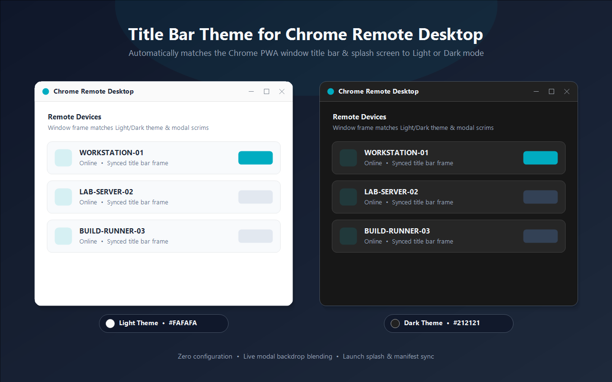

# Title Bar Theme for Chrome Remote Desktop

Matches the window title bar and startup screen of the [Chrome Remote Desktop](https://remotedesktop.google.com/) standalone Chrome app on Windows to Light or Dark mode.

## Preview

## Why It Exists

By default, Chrome Remote Desktop provides no title bar color to Chrome, leaving installed app windows with an unthemed frame across Light mode, Dark mode, and dimmed dialog overlays such as PIN prompts, host setup, and settings.

Once installed in Chrome, this extension matches the window title bar and startup screen to your active theme automatically with nothing to configure, and dims the bar smoothly whenever a dialog opens.

> [!NOTE]
> Window title bar coloring applies to standalone Chrome app windows (created via Chrome's menu **⋮ -> Cast, save, and share -> Install page as app...**). Regular Chrome browser tabs use Chrome's normal tab strip.

## Installation

1. Install **[Title Bar Theme for Chrome Remote Desktop](https://chromewebstore.google.com/detail/goeedkphpabkkmajcmngohomgmdodgaf)** from the Chrome Web Store, or clone this repository for local setup.
2. For a local copy, open `chrome://extensions/`, turn on **Developer mode**, click **Load unpacked**, and select this repository's root folder (containing `manifest.json`).
3. Open **Chrome Remote Desktop** (`https://remotedesktop.google.com/access/`) in its standalone Chrome app window—the title bar updates automatically with nothing to configure.

## Companion Projects

| Extension | Target App | What It Synchronizes |
| :--- | :--- | :--- |
| **[Title Bar Theme for Google Antigravity](https://github.com/tbruneel/chrome-extension-theme-for-antigravity)** | [Google Antigravity](https://antigravity.google.com/) | Light/Dark, Default/Strong Contrast, custom Appearance themes, modal/drawer scrims, and PWA launch splash. |
| **[Title Bar Theme for Chrome Remote Desktop](https://github.com/tbruneel/chrome-extension-theme-for-remote-desktop)** *(this repo)* | [Chrome Remote Desktop](https://remotedesktop.google.com/) | Light/Dark theme, PIN and settings dialog scrims, and PWA launch splash. |

## Documentation

- [Technical Documentation](./docs/technical.md) — Wiz theme and dialog scrim detection, PWA manifest redirect, permissions, and packaging.
- [Privacy Policy](./docs/privacy.md) — Local-only theme detection with zero network requests or data collection.
